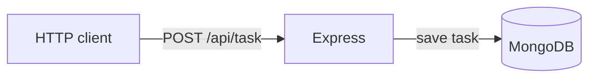

# TMS MERN training

Exercises from the NCE IT Club five-day MERN workshop. The repository contains JavaScript lessons, an Express/MongoDB task-creation API, and a React task-list layout.

The React page currently shows sample tasks. Its submit, edit and delete controls are not connected to the API; this is a learning workspace rather than a complete task manager.

## What is here

| Folder | Contents |
| --- | --- |
| [DAY-1](DAY-1/) | JavaScript exercises |
| [DAY-2](DAY-2/) | Browser and styling exercises |
| [NodeExpress/task-management-system-server](NodeExpress/task-management-system-server/) | Express API with a Mongoose task model |
| [React/task-management-reactApp](React/task-management-reactApp/) | React 18 / Vite 6 preview |



## Run the API

Use Node.js 20.19 or newer, npm and a local MongoDB instance. From the repository root:

```bash
cd NodeExpress/task-management-system-server
npm ci
[ -e .env ] || cp .env.example .env
npm start
```

The example connects to `mongodb://127.0.0.1:27017/task_management`. Set `MONGODB_URI` in your local `.env` for another database. The server starts on port 8080 after MongoDB connects. Do not commit connection credentials.

```bash
curl -X POST http://localhost:8080/api/task \
  -H 'Content-Type: application/json' \
  -d '{"name":"Test the robot"}'
```

A saved task returns `201`; missing/blank names return `400`, duplicate names `409`, and database write errors `500`. Only task creation is implemented. Authentication and the remaining CRUD endpoints are not present, so keep this exercise local.

A database credential was previously committed to this repository. Its owner must rotate or revoke it in MongoDB Atlas before reusing that account; removing it from the current source does not revoke the old credential or erase Git history.

## Preview the React layout

In another terminal, starting from the repository root:

```bash
cd React/task-management-reactApp
npm ci
npm run dev
```

Open the local URL Vite prints. `npm run build` creates `dist/`; `npm run lint` checks the source.

## Checks

Run `npm test` in the server directory. The endpoint tests use a local HTTP server with stubbed database writes; they cover response handling without contacting MongoDB. A real database is still needed to verify persistence end to end.

Installed dependencies and build output are ignored. Both npm lockfiles remain tracked so a fresh checkout can reinstall the declared packages.
